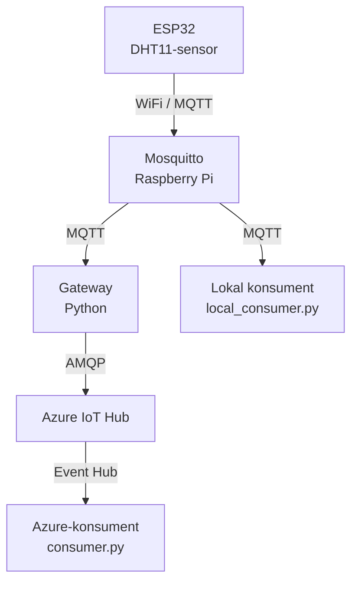

# IoT Telemetry Solution – ESP32, MQTT och Azure IoT Hub

En komplett IoT-lösning där en ESP32-enhet med DHT11-sensor skickar telemetri via MQTT till en lokal Mosquitto-broker på en Raspberry Pi. En gateway-applikation på Raspberry Pi vidarebefordrar datan till Azure IoT Hub. Två konsumenter visar telemetrin i realtid: en lokal MQTT-konsument och en Azure-konsument via Event Hub-kompatibla gränssnittet.

## Arkitektur



## Ingående delar

### 1. ESP32 (`esp32-sketcher/esp32_telemetry.ino`)

- Ansluter till WiFi.
- Läser temperatur och luftfuktighet från DHT11-sensorn.
- Publicerar JSON-meddelanden till Mosquitto.
- Använder topic-strukturen `telemetry/<deviceId>/<measurement>`.
- Har återanslutningslogik för både WiFi och MQTT.

Exempel på JSON-meddelande:

```json
{
  "deviceId": "sensor-01",
  "value": 21.4,
  "unit": "C"
}
```

Exempel på MQTT-topics:

- `telemetry/sensor-01/temperature`
- `telemetry/sensor-01/humidity`

### 2. Gateway (`gateway-app/gateway.py`)

- Prenumererar på `telemetry/sensor-01/#` och `telemetry/sensor-02/#`.
- Vidarebefordrar meddelanden till Azure IoT Hub.
- Använder en egen enhetsidentitet i Azure: `raspberry-gateway`.
- Hanterar Azure-fel och återanslutning.
- Använder miljövariabler för anslutningsuppgifter och hemligheter.

### 3. Azure-konsument (`azure-consumer/consumer.py`)

- Läser telemetri från Azure IoT Hubs inbyggda Event Hub-kompatibla slutpunkt.
- Visar `deviceId`, `value` och `unit` i realtid.

### 4. Lokal konsument (`gateway-app/local_consumer.py`)

- Prenumererar på `telemetry/#` direkt på Mosquitto.
- Visar telemetrin lokalt utan att behöva läsa den från Azure.

## Krav

### Hårdvara

- ESP32, exempelvis Arduino Nano ESP32 eller motsvarande.
- DHT11-temperatur- och luftfuktighetssensor.
- Raspberry Pi.

### Programvara

- Arduino IDE.
- Arduino-biblioteken:
  - WiFi
  - PubSubClient
  - ArduinoJson
  - DHT sensor library
- Python 3.10 eller senare på Raspberry Pi.
- Mosquitto 2.x.

### Azure

- Azure IoT Hub. F1 Free-tier kan räcka för enklare tester, beroende på aktuella tjänstevillkor och begränsningar.
- En registrerad IoT-enhet för gatewayen med namnet `raspberry-gateway`.

## Installation och körning

### 1. Konfigurera Mosquitto på Raspberry Pi

Skapa eller redigera konfigurationsfilen:

`/etc/mosquitto/conf.d/esp32.conf`

Lägg till:

```conf
listener 1883 0.0.0.0
allow_anonymous true
```

Starta om Mosquitto:

```bash
sudo systemctl restart mosquitto
```

Kontrollera att tjänsten lyssnar på port 1883:

```bash
sudo ss -lntp | grep 1883
```

Förväntat resultat innehåller exempelvis:

```text
0.0.0.0:1883
```

**Säkerhet:** `allow_anonymous true` tillåter anslutningar utan autentisering. Använd endast denna konfiguration i ett kontrollerat testnätverk. För en säkrare installation bör du aktivera autentisering och begränsa nätverksåtkomsten med brandväggsregler.

### 2. Konfigurera och starta ESP32

Öppna följande fil i Arduino IDE:

`esp32-sketcher/esp32_telemetry.ino`

Ange dina egna WiFi-uppgifter och Raspberry Pi-enhetens IP-adress:

```cpp
const char* WIFI_SSID = "YOUR_WIFI_SSID";
const char* WIFI_PASSWORD = "YOUR_WIFI_PASSWORD";
const char* MQTT_SERVER = "YOUR_PI_IP_ADDRESS";
```

Platshållarna ovan är exempel. Använd variabelnamnen som faktiskt finns i din sketch om de skiljer sig.

Därefter:

1. Välj rätt ESP32-kort och port i Arduino IDE.
2. Kompilera och ladda upp programmet till ESP32.
3. Öppna Serial Monitor med hastigheten 115200 baud.
4. Kontrollera att enheten ansluter till WiFi och Mosquitto och publicerar telemetri.

### 3. Installera och starta gatewayen

Öppna en terminal på Raspberry Pi och gå till projektmappen. Kör sedan:

```bash
cd gateway-app
python3 -m venv venv
source venv/bin/activate
pip install -r requirements.txt
```

Ange Azure IoT Hub-anslutningssträngen för enheten `raspberry-gateway`:

```bash
export AZURE_IOT_CONNECTION_STRING="HostName=...;DeviceId=raspberry-gateway;SharedAccessKey=..."
export MQTT_BROKER="localhost"
```

Starta gatewayen:

```bash
python gateway.py
```

Behåll terminalen öppen medan gatewayen körs.

**Obs:** Ersätt `...` med den riktiga anslutningssträngen från Azure. Dela inte strängen offentligt och lägg inte in den i Git-repot.

### 4. Starta Azure-konsumenten

Öppna en ny terminal på Raspberry Pi. Gå till projektmappen och kör:

```bash
cd azure-consumer
source ../gateway-app/venv/bin/activate
```

Ange Event Hub-kompatibla anslutningssträngen som hämtats från Azure IoT Hubs inbyggda slutpunkt:

```bash
export AZURE_EVENTHUB_CONNECTION_STRING="Endpoint=sb://...;SharedAccessKeyName=...;SharedAccessKey=...;EntityPath=..."
```

Starta konsumenten:

```bash
python consumer.py
```

Anslutningssträngen måste motsvara den konfiguration som konsumentkoden förväntar sig. Kontrollera även att den nödvändiga Event Hub-kompatibla slutpunkten och åtkomsten är konfigurerade i Azure.

### 5. Starta den lokala MQTT-konsumenten

Öppna en tredje terminal och kör:

```bash
cd gateway-app
source venv/bin/activate
export MQTT_BROKER="localhost"
python local_consumer.py
```

Den lokala konsumenten prenumererar på `telemetry/#` och visar inkommande MQTT-meddelanden.

## Miljövariabler

| Variabel | Används av | Beskrivning |
|---|---|---|
| `MQTT_BROKER` | Gateway och lokal konsument | IP-adress eller värdnamn till Mosquitto. Standardvärdet kan vara `localhost`. |
| `MQTT_PORT` | Gateway och lokal konsument | MQTT-port, vanligtvis `1883`. |
| `MQTT_USER` | Gateway | Användarnamn om MQTT-autentisering används. |
| `MQTT_PASS` | Gateway | Lösenord om MQTT-autentisering används. |
| `AZURE_IOT_CONNECTION_STRING` | Gateway | Anslutningssträng för Azure IoT-enheten `raspberry-gateway`. |
| `AZURE_EVENTHUB_CONNECTION_STRING` | Azure-konsument | Anslutningssträng för IoT Hubs Event Hub-kompatibla slutpunkt. |

Miljövariablernas namn måste överensstämma med de namn som används i Python-koden.

## Projektstruktur

```text
IoT-Telemetry-Projekt/
├── README.md
├── azure-consumer/
│   └── consumer.py
├── gateway-app/
│   ├── gateway.py
│   ├── local_consumer.py
│   └── requirements.txt
└── esp32-sketcher/
    └── esp32_telemetry.ino
```

## Felsökning

### ESP32 kan inte ansluta till Mosquitto

- Kontrollera att WiFi-uppgifterna är korrekta.
- Kontrollera Raspberry Pi-enhetens IP-adress.
- Kontrollera att Mosquitto körs.
- Kontrollera att port 1883 är tillgänglig från ESP32-enheten.

### Gatewayen skickar inte data till Azure

- Kontrollera att `AZURE_IOT_CONNECTION_STRING` är korrekt.
- Kontrollera att enheten `raspberry-gateway` finns registrerad i Azure IoT Hub.
- Kontrollera gatewayens loggar och internetanslutning.
- Kontrollera att de MQTT-topics som gatewayen prenumererar på motsvarar de topics som ESP32 publicerar.

### Azure-konsumenten visar inga meddelanden

- Kontrollera `AZURE_EVENTHUB_CONNECTION_STRING`.
- Kontrollera att konsumenten använder rätt slutpunkt och åtkomstuppgifter.
- Kontrollera att gatewayen faktiskt skickar telemetri till IoT Hub.
- Kontrollera felmeddelanden i konsumentens terminal.

### Den lokala konsumenten visar inga meddelanden

- Kontrollera att Mosquitto körs.
- Kontrollera att `MQTT_BROKER` pekar på rätt broker.
- Kontrollera att ESP32 publicerar på topics som matchar `telemetry/#`.

## Skalbarhet

Lösningen kan utökas med fler ESP32-enheter. Gatewayen är enligt konfigurationen avsedd att prenumerera på både `sensor-01` och `sensor-02`.

För att lägga till en andra sensor behöver du bland annat:

1. Konfigurera den andra enheten med ett unikt `deviceId`, exempelvis `sensor-02`.
2. Säkerställa att den publicerar på topics som `telemetry/sensor-02/temperature` och `telemetry/sensor-02/humidity`.
3. Kontrollera att gatewayens prenumerationer och meddelandehantering stöder den nya enheten.

## Säkerhet

- Lägg aldrig riktiga WiFi-lösenord eller Azure-nycklar i Git-repot.
- Använd miljövariabler eller en säker lösning för hemligheter.
- Lägg till en lämplig `.gitignore` om lokala konfigurationsfiler innehåller hemligheter.
- Undvik anonym MQTT-åtkomst i nätverk som inte är isolerade.
- Rotera nycklar om de råkar publiceras av misstag.

Alla anslutningssträngar och lösenord i dokumentationens exempel är platshållare och ska ersättas lokalt med riktiga värden.